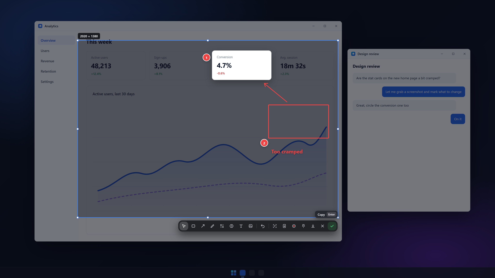

# PinShot

[中文](#中文) · [Download](https://github.com/motion-space/pinshot/releases/latest)

Screenshot, mark up and pin to the screen, PixPin-style, for Windows. Written in MoonBit with still.fail's
[mbui](https://github.com/AFK-surf/still.fail): the UI and logic are written once, and what is system-specific is a
thin native layer (Windows: `app/platform_win.c`, `app/capture_wgc.cpp`).



## Install

Download `PinShot-Setup-<version>.exe` from [Releases](https://github.com/motion-space/pinshot/releases/latest) and run
it. It installs for the current user (no administrator needed), adds a Start menu entry and an uninstall entry in
Settings › Apps, and can start PinShot with Windows. `pinshot.exe` on the same page is the portable build: one file,
run it from anywhere.

The installer is not code-signed: Windows SmartScreen may say "Windows protected your PC"; choose More info › Run
anyway. Windows 10 2004 or later, x64.

## Use

- `Ctrl+Alt+A` (or click the tray icon): freeze the monitor under the pointer and capture (the shortcut can be changed
  in the settings)
  - Click without moving: select the window under the pointer; drag: select an area; drag edges and corners: resize;
    arrow keys: move the selection 1 px (Shift: 10 px)
  - Toolbar: rectangle, ellipse, arrow, line (Shift: horizontal, vertical or 45°), pen, mosaic, numbered marker, text,
    undo / redo, pin, save, close, copy
  - `Enter`, `Ctrl+C` or double-click in the selection: copy; `Ctrl+S`: save; `Ctrl+T`: pin; `Ctrl+Z` / `Ctrl+Y`:
    undo / redo; `C`: copy the colour under the pointer
  - Right-click: clear the selection, again to quit; `Esc`: quit
- Pins: drag to move; wheel to zoom; `Ctrl+wheel` for opacity; double-click or `Esc` to close; the right-click menu has
  copy, save as, always on top, original size, opacity, close all
- `Ctrl+2`: pin the image on the clipboard
- Tray menu: capture, pin clipboard, show / hide all pins, settings, open the screenshots folder, quit
- Command line: `pinshot.exe --settings`, `pinshot.exe --quit`, `pinshot.exe --bench` (times the capture)

Settings are in `%APPDATA%\PinShot\settings.json`, the log (each capture's timings) in `%APPDATA%\PinShot\pinshot.log`.

## How it works

- One resident process. The frozen-screen overlay is mbui's main window (hidden between captures); each pin and the
  settings are mbui child windows in the same process.
- Each monitor keeps a Windows.Graphics.Capture session holding only its latest frame; as the shortcut is pressed that
  frame is copied to a staging texture (a few ms). A frame older than 5 s is not trusted: the session is made again and
  its first frame waited for. Sessions are also made again as monitors wake, on resume and unlock. HDR monitors are
  captured in FP16 and brought back to SDR by the SDR white level on the GPU. GDI BitBlt is the fallback;
  `PINSHOT_CAPTURE=gdi` turns the resident sessions off.
- `patches/mbui-pinshot.patch`: lets mbui make a texture straight from those pixels, and makes its glyph atlas
  1024² instead of 4096² (64 MB of video memory).
- Marks are kept in monitor pixels; the overlay and the export draw the same nodes, and the export is composed on the
  GPU at the original resolution by mbui's `take_picture`.

## Build

Needs Visual Studio 2022 (C++), Git for Windows (Git Bash) and MoonBit (`moon` on PATH).

```powershell
scripts/build.ps1            # out/build/pinshot.exe (warnings are errors)
scripts/install.ps1          # installs it for you and starts it
packaging/pack-setup.ps1     # out/setup/PinShot-Setup-<version>.exe (Inno Setup 6)
packaging/pack-msix.ps1      # the Microsoft Store package
```

`scripts/fetch-stillfail.sh` (run by the build) fetches still.fail's `apps/mbui` and `libs/mbui` at the commit in
`stillfail.lock` into `deps/stillfail` and applies `patches/`.

## License

[MIT](LICENSE). The shutter sound (`assets/shutter.wav`) was generated with ElevenLabs.

---

## 中文

截图、标注、贴图（PixPin 式）的 Windows 工具，用 MoonBit 和 still.fail 的 mbui 写成：界面和逻辑只写一份，系统相关的部分是很薄的原生层。

### 安装

在 [Releases](https://github.com/motion-space/pinshot/releases/latest) 下载 `PinShot-Setup-<版本>.exe` 运行即可：装在当前用户下，不需要管理员权限，会建开始菜单快捷方式、在「设置 › 应用」里加卸载项，可选开机自启。同一页的 `pinshot.exe` 是免安装版，单个文件，放哪里都能直接运行。

安装包没有代码签名，第一次运行时 SmartScreen 可能提示「Windows 已保护你的电脑」，点「更多信息 › 仍要运行」。需要 Windows 10 2004 及以上、x64。

### 用法

- `Ctrl+Alt+A`（或点托盘图标）：冻结鼠标所在的显示器进入截图（设置里可换快捷键）
  - 不动鼠标点一下选中窗口；拖动框选；拖边和角调整大小；方向键移动 1 像素（Shift 10 像素）
  - 工具条：矩形、椭圆、箭头、直线（按住 Shift 只走水平、垂直或 45°）、画笔、马赛克、序号、文字、撤销 / 重做、贴图、保存、关闭、复制
  - `Enter`、`Ctrl+C` 或在选区里双击：复制；`Ctrl+S` 保存；`Ctrl+T` 贴图；`Ctrl+Z` / `Ctrl+Y` 撤销 / 重做；`C` 复制鼠标下的颜色
  - 右键先取消选区，再右键退出；`Esc` 退出
- 贴图：拖动移动；滚轮缩放；`Ctrl+滚轮` 调透明度；双击或 `Esc` 关闭；右键菜单有复制、另存为、置顶、原始大小、不透明度、关闭全部
- `Ctrl+2`：把剪贴板里的图片贴到屏幕上
- 托盘右键：截图、贴剪贴板图片、显示 / 隐藏全部贴图、设置、打开截图文件夹、退出

设置在 `%APPDATA%\PinShot\settings.json`，日志在 `%APPDATA%\PinShot\pinshot.log`。

### 构建

需要 Visual Studio 2022（C++）、Git for Windows、MoonBit（`moon` 在 PATH 上），命令见上面的 Build 一节。

### 许可证

[MIT](LICENSE)。快门声（`assets/shutter.wav`）由 ElevenLabs 生成。
