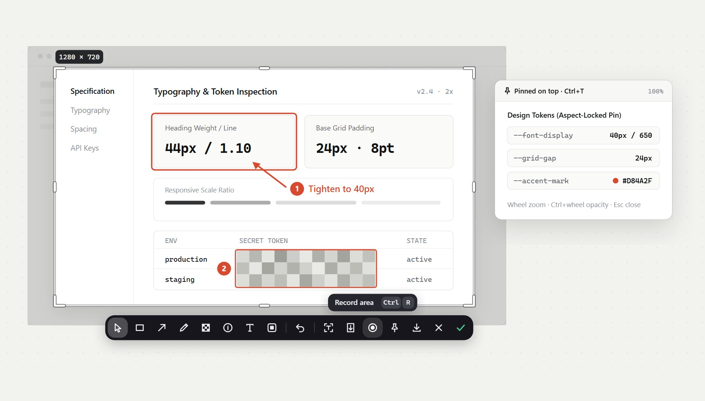

# PinShot

**English** · [简体中文](README.zh-CN.md) · [Download](https://pin-shot.pages.dev) · [Releases](https://github.com/motion-space/pinshot/releases/latest)

Fast, PixPin-style screenshot, annotation, pinning, and screen recording for Windows and macOS. Written in MoonBit with still.fail's [mbui](https://github.com/AFK-surf/still.fail): the UI and core logic are written once, backed by a thin native layer in `app/` for Windows and macOS.



## Features

- **Instant capture**: smart window detection, area drag & edge/corner resize, pixel nudging, magnifier, and color picker (`C`); HDR-aware on Windows (WGC FP16 tone-mapped back to SDR on the GPU).
- **Markup & beautify**: shapes (rectangle, ellipse, focus spotlight), arrows & lines (`Shift` snaps to 0°/45°/90°), pen & eraser, redaction (pixel mosaic, brush mosaic, blur), numbered markers, text, and one-click **background beautify** (`B`, gradients / solid / desktop wallpaper with rounded corners & shadow).
- **Screen pins**: pin any capture or clipboard image (`Ctrl+2` / `⌃2`) as a floating window with zoom, opacity, rotation, flip, always-on-top, and OCR.
- **Offline OCR**: read text from any selection or pin (`Ctrl+O`) on the device: Windows' built-in OCR engine, Apple's Vision framework on macOS.
- **Scrolling screenshot**: capture tall pages or chats (`Ctrl+L` / `⌘L`) in either direction.
- **Area screen recording**: record any region (`Ctrl+R` / `⌘R`) to hardware-accelerated **MP4 (H.265 / H.264, plus AV1 on Windows)** or **GIF**, with optional system audio, click/keycap overlay, and a compact post-recording Studio HUD for format, quality/FPS, and proportional scaling (`100% / 75% / 50%`).
- **Verified updates**: opt-in background updates on Windows signed with ECDSA P-256 and verified before download.

## Installation

### Windows

Requires Windows 10 (2004+) or Windows 11, x64.

- **Installer**: download `PinShot-Setup.exe` from [pin-shot.pages.dev](https://pin-shot.pages.dev) (or [Releases](https://github.com/motion-space/pinshot/releases/latest)). Installs per-user (no administrator needed), adds a Start menu entry and Settings › Apps uninstaller, and optionally starts with Windows.
- **Portable**: download `pinshot.exe` from the same page — a single self-contained executable that runs from anywhere.

> The installer is not code-signed yet. If Windows SmartScreen warns *"Windows protected your PC"*, click **More info › Run anyway**.

Settings live in `%APPDATA%\PinShot\settings.json`; logs (including per-capture timings) live in `%APPDATA%\PinShot\pinshot.log`.

### macOS

Requires macOS 14+ on Apple silicon.

1. Download `PinShot-mac.zip` from [pin-shot.pages.dev](https://pin-shot.pages.dev) (or [Releases](https://github.com/motion-space/pinshot/releases/latest)).
2. Unzip and drag `PinShot.app` to **Applications**, then open it.
3. On the first capture, grant permission in **System Settings › Privacy & Security › Screen & System Audio Recording**, then quit and reopen PinShot. If PinShot is not listed, click **+** and select `PinShot.app`.

Settings and logs live in `~/Library/Application Support/PinShot/`. macOS builds use ad-hoc signing (not notarized); replacing the app with a newly built ad-hoc copy may require re-granting screen recording permission.

## Usage & Shortcuts

### Capture & Markup

| Action | Windows | macOS |
| --- | --- | --- |
| Start capture | `Ctrl+Alt+A` (or click tray icon) | `⌃⌥A` (or click menu bar icon) |
| Pin clipboard image | `Ctrl+2` | `⌃2` |
| Select window / area | Click without moving / drag | Click without moving / drag |
| Nudge selection | Arrow keys (`1 px`), `Shift+Arrow` (`10 px`) | Arrow keys (`1 px`), `Shift+Arrow` (`10 px`) |
| Select whole screen | `Ctrl+A` | `⌘A` |
| Copy color under pointer | `C` | `C` |
| Toggle background beautify | `B` | `B` |
| Undo / Redo | `Ctrl+Z` / `Ctrl+Y` (`Ctrl+Shift+Z`) | `⌘Z` / `⇧⌘Z` |
| Copy image | `Enter`, `Ctrl+C`, or double-click selection | `Enter`, `⌘C`, or double-click selection |
| Save (PNG / JPEG) | `Ctrl+S` | `⌘S` |
| Pin to screen | `Ctrl+T` | `⌘T` |
| Extract text (OCR) | `Ctrl+O` | `⌘O` |
| Scrolling screenshot | `Ctrl+L` | `⌘L` |
| Screen recording | `Ctrl+R` | `⌘R` |
| Clear selection / Quit | Right-click (twice to quit) or `Esc` | Right-click (twice to quit) or `Esc` |

### Pins

- **Move & resize**: drag to move; drag any edge or corner to resize keeping aspect ratio (`Shift` to stretch freely); scroll wheel to zoom.
- **Opacity**: `Ctrl+wheel` to adjust transparency.
- **Close**: double-click or `Esc`.
- **Context menu**: copy, save as, extract text, always on top, rotate 90° left/right (`Ctrl+Shift+R` / `Ctrl+R`), flip horizontally/vertically, reset (`Ctrl+0`), opacity, close all.

### Tray / Menu Bar & Command Line

- **Tray / menu bar**: capture, pin clipboard, show/hide all pins, settings, open screenshots folder, check for updates, quit.
- **Windows CLI**:
  - `pinshot.exe --settings` — open Settings
  - `pinshot.exe --quit` — exit the running instance
  - `pinshot.exe --bench` — benchmark capture & window enumeration timings
  - `pinshot.exe --ocr <image>` — print OCR text from an image file (on macOS: `PinShot.app/Contents/MacOS/PinShot --ocr <image>`)

### Updates (Windows)

**Settings › About** provides **Check for updates** and an **Automatic updates** toggle (off by default). When enabled, PinShot checks [`latest.json`](https://pin-shot.pages.dev/dl/latest.json) once a day, verifies the **ECDSA P-256** release signature against the built-in public key, downloads and verifies SHA-256 in the background, and installs once idle (no capture, no open pins, 2 minutes idle). Failed updates leave the current version intact. The Microsoft Store build is updated exclusively by the Store.

## How It Works

- **Single resident process**: the frozen-screen overlay is mbui's main window (kept hidden between captures); pins, settings, and the recording HUD are child windows in the same process.
- **Low-latency capture**: on Windows, each monitor keeps a `Windows.Graphics.Capture` session holding only its latest frame, copied to a staging texture in a few milliseconds on hotkey press. Frames older than 5 s trigger a fresh session; sessions also rebuild on monitor wake, resume, and unlock. HDR monitors capture in FP16 and tone-map by the OS SDR white level on the GPU. GDI `BitBlt` is the automatic fallback (`PINSHOT_CAPTURE=gdi` forces GDI).
- **GPU-composed export**: annotations are stored in monitor pixels and rendered identically in the overlay and GPU export (`mbui` `take_picture`) at native resolution.
- **`patches/mbui-pinshot.patch`**: lets mbui build textures directly from raw staging pixels and trims the glyph atlas from 4096² to 1024² (saving ~64 MB VRAM).

## Build from Source

### Windows

Requires Visual Studio 2022 (C++ Desktop workload), Git for Windows (Git Bash), and [MoonBit](https://www.moonbitlang.com/) (`moon` on `PATH`).

```powershell
scripts/build.ps1                # out/build/pinshot.exe (warnings are errors)
scripts/install.ps1              # installs to %LOCALAPPDATA%\Programs\PinShot and launches it
packaging/pack-setup.ps1         # out/setup/PinShot-Setup-<version>.exe (requires Inno Setup 6)
packaging/pack-msix.ps1          # Microsoft Store MSIX package
```

`scripts/fetch-stillfail.sh` (invoked automatically by the build) fetches still.fail's `apps/mbui` and `libs/mbui` at the commit pinned in `stillfail.lock` into `deps/stillfail` and applies `patches/`.

### macOS

Requires Xcode Command Line Tools and [MoonBit](https://www.moonbitlang.com/) (`moon` on `PATH`).

```bash
bash scripts/build-mac.sh
open out/build/PinShot.app
```

The **macOS package** GitHub Actions workflow also builds `PinShot-mac.zip` on demand and on every `v*` tag.

## Sponsor

PinShot is free and open source. If you find it useful, you can support development on the [sponsor page](https://pin-shot.pages.dev/support) (WeChat Reward / Ko-fi), also linked under **Settings › About**.

## License

[MIT](LICENSE). The shutter sound (`assets/shutter.wav`) was generated with ElevenLabs.
