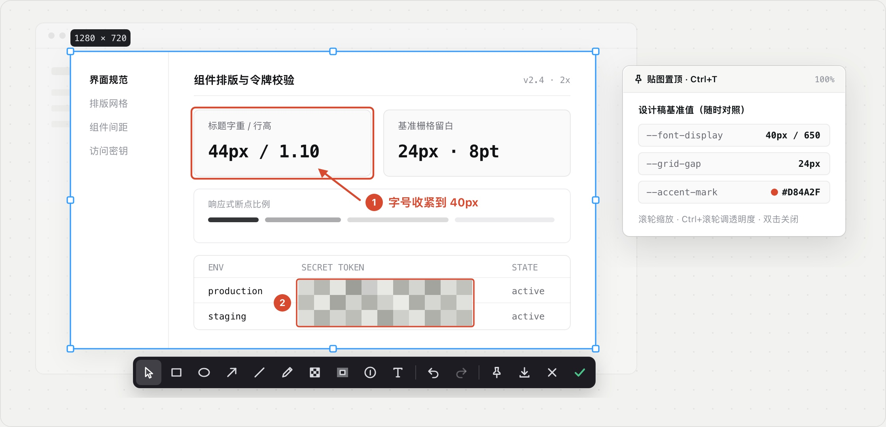

# PinShot

[English](README.md) · **简体中文** · [官网下载](https://pin-shot.pages.dev) · [Releases](https://github.com/motion-space/pinshot/releases/latest)

轻量、快速、PixPin 风格的跨平台截图、标注、贴图与区域录屏工具，支持 Windows 与 macOS。使用 MoonBit 与 still.fail 的 [mbui](https://github.com/AFK-surf/still.fail) 编写：界面与核心逻辑只写一份，系统相关能力封装在 `app/` 下的薄原生层中。



## 功能特性

- **极速截屏**：自动识别窗口、自由框选与拖边调大小、方向键微调、放大镜取色（`C`）；Windows 下基于 WGC 常驻会话毫秒级出图，并支持 HDR 显示器 FP16 采集与 GPU 自动还原 SDR 色彩。
- **丰富标注与一键美化**：形状（矩形 / 椭圆 / 聚焦）、线条（箭头 / 直线，按住 `Shift` 吸附水平、垂直或 45°）、画笔与橡皮擦、打码（像素框选 / 涂抹马赛克 / 模糊遮罩）、序号、文字，以及一键**美化背景**（`B`，内置渐变 / 浅灰 / 纯白 / 桌面壁纸、超椭圆圆角与阴影）。
- **屏幕贴图**：将截图或剪贴板图片（`Ctrl+2` / `⌃2`）贴在屏幕最前，支持滚轮缩放、透明度调节、旋转翻转、置顶与取词。
- **离线文字识别（OCR）**：选区或贴图内按 `Ctrl+O`，在本机离线识别中英数字（Windows 自带 OCR 引擎，macOS 用系统 Vision 框架），弹窗校对后一键复制。
- **长截图**：选区按 `Ctrl+L`（macOS `⌘L`） 向上/向下滚动拼接长图。
- **区域录屏**：选区按 `Ctrl+R`（macOS `⌘R`）录制区域视频，支持系统声音与鼠标点击/按键浮层；录完后在紧凑的横向浮窗内直接选择 **MP4（H.265 / H.264，Windows 另有 AV1）** 或 **GIF**、画质/帧率与等比缩放（`100% / 75% / 50%`），同参数二次导出秒级复用。
- **安全自动更新**：Windows 端支持可选后台自动更新，每个版本使用 ECDSA P-256 私钥签名、内置公钥验签后才下载安装。

## 安装

### Windows

需要 Windows 10（2004 及以上）或 Windows 11，x64。

- **安装包**：前往 [pin-shot.pages.dev](https://pin-shot.pages.dev)（或 [Releases](https://github.com/motion-space/pinshot/releases/latest)）下载 `PinShot-Setup.exe` 运行。安装到当前用户目录，无需管理员权限，自动添加开始菜单入口与「设置 › 应用」卸载项，可选开机自启。
- **免安装便携版**：同页下载 `pinshot.exe`，单文件放任意位置即可直接运行。

> 安装包目前未做商业代码签名，首次运行若触发 Windows SmartScreen 提示「Windows 已保护你的电脑」，点击**更多信息 › 仍要运行**即可。

配置文件位于 `%APPDATA%\PinShot\settings.json`，运行日志（含每次截图耗时）位于 `%APPDATA%\PinShot\pinshot.log`。

### macOS

需要 macOS 14 或更新版本、Apple 芯片（Apple Silicon）。

1. 前往 [pin-shot.pages.dev](https://pin-shot.pages.dev)（或 [Releases](https://github.com/motion-space/pinshot/releases/latest)）下载 `PinShot-mac.zip`。
2. 解压后将 `PinShot.app` 拖入「应用程序」文件夹并打开。
3. 首次截图时，在「**系统设置 › 隐私与安全性 › 屏幕与系统音频录制**」（部分系统显示为「屏幕录制」）中允许 PinShot，然后退出并重新打开。若列表中没有 PinShot，点击 **+** 手动选择 `PinShot.app`。

配置与日志位于 `~/Library/Application Support/PinShot/`。macOS 包使用 ad-hoc 签名（未经 Apple 公证），重新编译替换后系统可能需要重新授权屏幕录制权限。

## 使用与快捷键

### 截图与标注

| 操作 | Windows | macOS |
| --- | --- | --- |
| 开始截图 | `Ctrl+Alt+A`（或点击托盘图标） | `⌃⌥A`（或点击菜单栏相机图标） |
| 贴剪贴板图片 | `Ctrl+2` | `⌃2` |
| 选窗口 / 框选区域 | 原地单击 / 拖动框选 | 原地单击 / 拖动框选 |
| 微调选区位置 | 方向键（`1 px`）、`Shift+方向键`（`10 px`） | 方向键（`1 px`）、`Shift+方向键`（`10 px`） |
| 选中整个屏幕 | `Ctrl+A` | `⌘A` |
| 复制指针处颜色 | `C` | `C` |
| 开启 / 关闭美化背景 | `B` | `B` |
| 撤销 / 重做 | `Ctrl+Z` / `Ctrl+Y`（`Ctrl+Shift+Z`） | `⌘Z` / `⇧⌘Z` |
| 复制到剪贴板 | `Enter`、`Ctrl+C` 或选区内双击 | `Enter`、`⌘C` 或选区内双击 |
| 保存图片（PNG / JPEG） | `Ctrl+S` | `⌘S` |
| 贴到屏幕 | `Ctrl+T` | `⌘T` |
| 提取文字（OCR） | `Ctrl+O` | `⌘O` |
| 滚动长截图 | `Ctrl+L` | `⌘L` |
| 区域录屏 | `Ctrl+R` | `⌘R` |
| 取消选区 / 退出 | 右键（再点右键退出）或 `Esc` | 右键（再点右键退出）或 `Esc` |

### 贴图

- **移动与缩放**：拖动移动；拖任意边或角等比缩放（按住 `Shift` 自由拉伸）；滚轮缩放。
- **透明度**：`Ctrl+滚轮` 调节不透明度。
- **关闭**：双击贴图或按 `Esc`。
- **右键菜单**：复制、另存为、提取文字、置顶、向左 / 向右旋转 90°（`Ctrl+Shift+R` / `Ctrl+R`）、水平 / 垂直翻转、重置（`Ctrl+0`）、不透明度、关闭全部。

### 托盘 / 菜单栏与命令行

- **托盘 / 菜单栏右键**：截图、贴剪贴板图片、显示 / 隐藏全部贴图、设置、打开截图文件夹、检查更新、退出。
- **Windows 命令行**：
  - `pinshot.exe --settings` — 打开设置窗口
  - `pinshot.exe --quit` — 退出正在运行的实例
  - `pinshot.exe --bench` — 测试截屏与窗口枚举耗时
  - `pinshot.exe --ocr <图片路径>` — 对指定图片执行离线 OCR 并输出文本

### 更新机制（Windows）

「**设置 › 关于**」提供**检查更新**按钮与**自动更新**开关（默认关闭）。开启后每天检查一次 [`latest.json`](https://pin-shot.pages.dev/dl/latest.json)，用内置公钥验证 **ECDSA P-256** 签名通过后才在后台下载并校验 SHA-256，并在 PinShot 空闲时（无截图、无贴图、两分钟无键鼠操作）静默升级重启；更新失败时保持当前版本正常运行。Microsoft Store 版由商店托管更新，不会自行联网检查。

## 实现原理

- **单进程常驻**：冻结屏遮罩为 mbui 主窗口（非截图状态隐藏），贴图、设置页与录屏浮窗均为同进程子窗口。
- **低延迟采帧与 HDR 还原**：Windows 下每个显示器常驻一个 `Windows.Graphics.Capture` 会话、仅保留最新帧，按下快捷键时几毫秒内拷贝到 staging 纹理；帧超过 5 秒或显示器唤醒 / 解锁后自动重建会话。HDR 屏采用 FP16 采帧并在 GPU 上按系统 SDR 白点还原；GDI `BitBlt` 作为自动兜底（设置环境变量 `PINSHOT_CAPTURE=gdi` 可关闭常驻会话）。
- **GPU 原分辨率合成**：标注坐标以显示器像素存储，预览遮罩与最终导出共用同一套 mbui 节点树，由 `take_picture` 在 GPU 上按原始分辨率合成导出。
- **`patches/mbui-pinshot.patch`**：允许 mbui 直接从原生像素缓冲创建纹理，并将字形图集从 4096² 缩减至 1024²（节省约 64 MB 显存）。

## 从源码构建

### Windows

需要 Visual Studio 2022（C++ 桌面开发组件）、Git for Windows（Git Bash）以及 [MoonBit](https://www.moonbitlang.com/)（`moon` 在 `PATH` 中）。

```powershell
scripts/build.ps1                # 生成 out/build/pinshot.exe（警告即错误）
scripts/install.ps1              # 安装到 %LOCALAPPDATA%\Programs\PinShot 并启动
packaging/pack-setup.ps1         # 打包 out/setup/PinShot-Setup-<版本>.exe（需要 Inno Setup 6）
packaging/pack-msix.ps1          # 打包 Microsoft Store MSIX
```

构建脚本会自动调用 `scripts/fetch-stillfail.sh`，按 `stillfail.lock` 锁定的提交拉取 still.fail 的 `apps/mbui` 和 `libs/mbui` 到 `deps/stillfail` 并应用 `patches/` 补丁。

### macOS

需要安装 Xcode 命令行工具和 [MoonBit](https://www.moonbitlang.com/)（`moon` 在 `PATH` 中）。

```bash
bash scripts/build-mac.sh
open out/build/PinShot.app
```

GitHub Actions 中的 **macOS package** 工作流会在手动触发或推送 `v*` 标签时自动构建并产出 `PinShot-mac.zip`。

## 赞助支持

PinShot 免费开源。如果它对你有帮助，欢迎前往[赞助页](https://pin-shot.pages.dev/support?lang=zh)请作者喝杯咖啡（微信赞赏 / Ko-fi），「**设置 › 关于**」内同样提供了入口。

## 许可证

[MIT](LICENSE)。快门声（`assets/shutter.wav`）由 ElevenLabs 生成。
